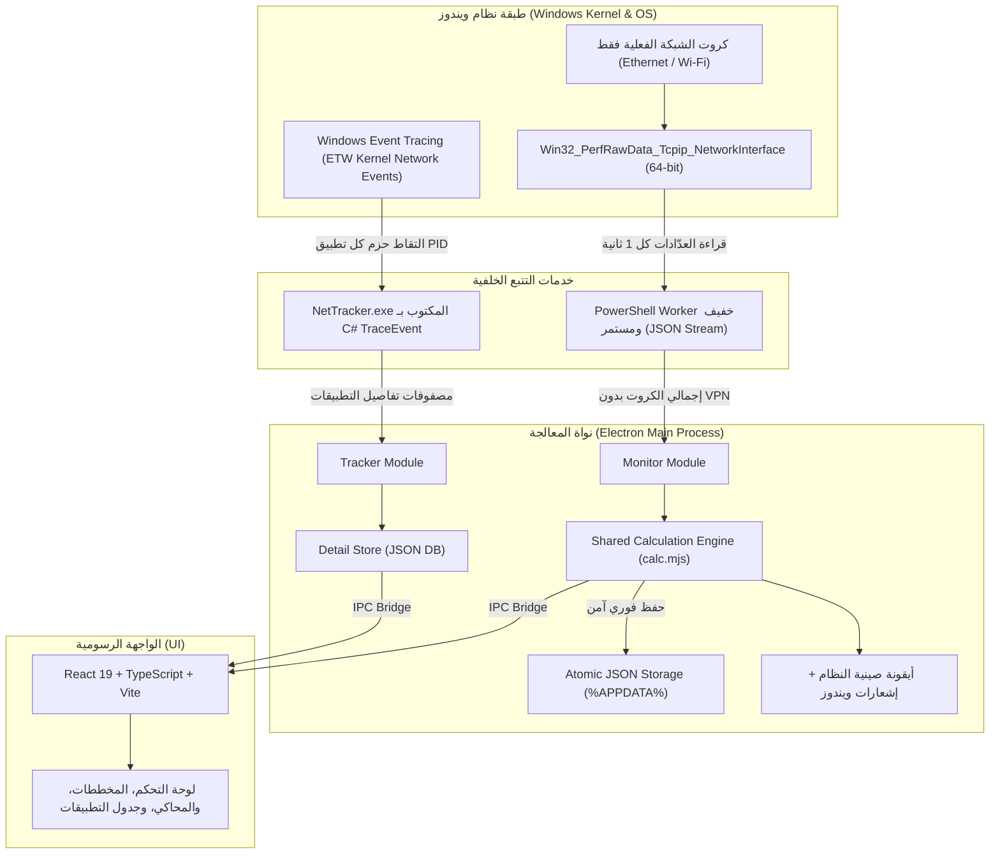

<div align="center">


# عدّاد الإنترنت · Internet Meter

**تطبيق ويندوز مفتوح المصدر لمتابعة استهلاك باقة الإنترنت الشهرية وتفاصيل استهلاك كل تطبيق بدقة ولحظةً بلحظة**  
*A modern, lightweight Windows desktop app to monitor your monthly data quota and per-app usage in real-time.*

<p align="center">
  <a href="#-بالعربية"><strong>العربية</strong></a> •
  <a href="#-english"><strong>English</strong></a> •
  <a href="https://github.com/raiedahmed/InternetMeter/releases/latest"><strong>تحميل المثبّت ⬇️</strong></a> •
  <a href="#-المميزات-الرئيسية"><strong>المميزات</strong></a> •
  <a href="#-كيف-يعمل-البرنامج"><strong>كيف يعمل؟</strong></a> •
  <a href="#-البناء-من-المصدر-developer-guide"><strong>للمطورين</strong></a>
</p>

---

[](https://github.com/raiedahmed/InternetMeter/releases/latest)
[](https://github.com/raiedahmed/InternetMeter/releases)
[](https://www.electronjs.org/)
[](https://react.dev/)
[](https://www.typescriptlang.org/)
[](https://vitejs.dev/)
[](LICENSE)
[](#-الخصوصية-والأمان--privacy)

</div>

<br />

---

## 🇪🇬 بالعربية

### 💡 لماذا «عدّاد الإنترنت»؟
يعاني ملايين المستخدمين في الشرق الأوسط ومصر ومختلف الدول من نفاد باقة الإنترنت المنزلي الشهرية قبل موعد تجديدها بأيام، وغالباً دون معرفة السبب أو تحديد التطبيق الذي استنزف الرصيد في الخلفية (سواء كان تحديثات ويندوز، ألعاب Steam، فيديوهات، أو برامج تواصل).

برامج مراقبة الشبكة التقليدية معقدة، ثقيلة على المعالج، مليئة بالإعلانات، أو تنتهك الخصوصية بإرسال بياناتك لخوادم خارجية. 

صُمم **«عدّاد الإنترنت»** ليكون الحل الأبسط، الأخف، والأذكى:
- **مجاني 100% ومفتوح المصدر بالكامل.**
- **تفاصيل استهلاك كل تطبيق (Per-App Breakdown):** تعرف بالضبط أي البرامج سحبت الباقة (اليوم، آخر 7 أيام، الدورة الحالية، أو آخر 30 يوماً).
- **محلي تماماً (Offline-first):** لا يسجل حسابات، لا يتصل بأي خوادم خارجية، ولا يجمع أي بيانات.
- **واجهة عصرية ثنائية اللغة (عربي / English)** تدعم اليمين لليسار (RTL) بشكل أصيل.
- **حساب رياضي ذكي** لا يكتفي بعرض الأرقام، بل يجيبك عن السؤال الأهم: *هل ستكفيني الباقة حتى يوم التجديد؟ وكم أستطيع استهلاكه اليوم بأمان؟*

---

### ✨ المميزات الرئيسية

| الميزة | الوصف الفني والوظيفي |
| :--- | :--- |
| ⚡ **عدّاد فوري مباشر** | قياس لحظي لسرعة التحميل (Download) والرفع (Upload) بالثانية مع إجمالي استهلاك اليوم. |
| 🪟 **ويدجت عائم على سطح المكتب** | ويدجت مصغر شفاف ودائم في المقدمة (Always-on-top) قابل للسحب، يعرض السرعة الحالية واستهلاك اليوم فوراً. |
| 📱 **الاستهلاك لكل تطبيق (ETW)** | تتبع دقيق لاستهلاك كل برنامج وعملية (Process) على جهازك مع فلترة حسب (اليوم / 7 أيام / الدورة / 30 يوماً). |
| 🌐 **الوجهات والتوقيت** | تبويب «الوجهات» يجمّع المواقع والخوادم تحت نطاقها الرئيسي (مثل `googlevideo.com`)، وبالضغط على أي تطبيق ترى إلى أين ذهبت بياناته بالضبط. تبويب «التوقيت» يعرض الاستهلاك حسب ساعات اليوم وأوقات الذروة. |
| 📡 **رادار أجهزة الشبكة والراوتر** | كشف كافة الأجهزة والهواتف المتصلة بالراوتر والواي فاي وعناوين IP و MAC الخاصة بها. |
| 📑 **تقرير دورة الفوترة الشامل** | ملخص مالي واستهلاكي كامل للدورة قابل للطباعة (`Print to PDF`)، تصدير ملفات `CSV`، ونسخ ملخص نصي فوري. |
| 🌙 **حساب الساعات الليلية المجانية** | إمكانية تحديد نافذة تحميل ليلي (مثلاً 2:00 ص إلى 8:00 ص) لحساب استهلاكها بشكل مستقل أو استثنائها من الرصيد. |
| 💰 **الحساب المالي والتكلفة** | حساب تكلفة الجيجابايت، تكلفة استهلاك اليوم، وتكلفة الاستهلاك المتوقع بالعملة المحلية (ج.م / ر.س / $). |
| 🚨 **كشف تسريب البيانات بالخلفية** | تنبيه ذكي فوري عند رصد سحب بيانات مرتفع ومستمر (أعلى من 3.5 MB/s) في الخلفية. |
| 🌱 **وضع التوفير (Eco Mode)** | تحذيرات مشددة عند الاقتراب من تجاوز الحصة اليومية الآمنة لترشيد الباقة. |
| 🎯 **الحصة اليومية الآمنة** | خوارزمية ذكية تحسب `المتبقي ÷ الأيام المتبقية` لتعطيك سقفاً يومياً محدداً يضمن بقاء الباقة حتى آخر يوم. |
| 🔮 **نظام التنبؤ الذكي** | يتنبأ بتاريخ نفاد الباقة الفعلي بناءً على متوسط وتيرة استهلاكك اليومي مقارنة بدورة الفوترة. |
| 📅 **دورة فوترة قابلة للتخصيص** | حدد يوم تجديد باقتك (من 1 إلى 31)، ويتولى البرنامج إدارة بدايات ونهايات الشهور تلقائياً بما فيها الأشهر الكبيسة. |
| 🎚️ **معايرة الأرقام مع شركة الاتصالات** | هل قمت بتثبيت البرنامج في منتصف الشهر؟ أدخل الاستهلاك الحالي من تطبيق شركتك (مثل WE، فودافون، أورنج، إي آند، STC وغيرها) ليضبط العداد نفسه تلقائياً. |
| 🔔 **إشعارات ويندوز متدرجة** | تنبيهات أصلية بنظام ويندوز عند استهلاك (50%، 80%، 90%، 95%) لتنبيهك قبل استنزاف الرصيد. |
| 🧮 **محاكي "ماذا يعني المتبقي؟"** | ترجمة الجيجابايت المتبقية إلى استخدامات ملموسة: ساعات مشاهدة YouTube بدقة 1080p، ساعات مكالمات فيديو، عدد أفلام Full HD، وساعات موسيقى. |
| 📊 **مخطط بياني للاستهلاك اليومي** | رسم بياني تفاعلي يوضح استهلاك كل يوم من أيام الدورة مع خط مقارنة واضح بالحصة الآمنة. |
| 🧷 **خفيف ويعمل في صينية النظام (Tray)** | يختفي بجوار الساعة، يستهلك أقل قدر من الذاكرة (RAM)، ويدعم التشغيل التلقائي مع إقلاع ويندوز. |
| 🔄 **تعويض ذكي للاستهلاك أثناء الإغلاق** | إذا أغلقت البرنامج واستمر تشغيل الجهاز، يكتشف البرنامج عند فتحه مجدداً فارق العدادات في نفس الجلسة ويعوض الاستهلاك بدقة. |

---

### 🏛️ كيف يعمل البرنامج؟ (المعمارية التقنية)

يعتمد البرنامج على معمارية هجينة خفيفة تجمع بين كفاءة **Electron & React 19** وسرعة استعلامات **Windows CIM** وتتبع أنوية ويندوز **ETW**:



#### 🔍 لماذا استخدام هذا الدمج الفريد؟
1. **عدّادات 64-بت نقية:** لا تصفر أبداً عند تخطي حاجز 4 جيجابايت.
2. **توافق كامل:** تعمل مع كافة كروت الشبكة والـ Wi-Fi حتى كروت USB الخارجية.
3. **فلترة مشددة لكروت الشبكة الفيزيائية فقط:** عبر `Get-NetAdapter -Physical` لمنع احتساب حزم الـ VPN أو الآلات الافتراضية (Hyper-V / VMware / VirtualBox / Docker) مرتين.
4. **تتبع دقيق للتطبيقات (ETW):** يتم إسناد كل بايت إلى اسم التطبيق وأيقونته دون اعتراض حركة البيانات أو التأثير على السرعة.

---

### ⚖️ مقارنة: عدّاد الإنترنت مقابل البدائل

| وجه المقارنة | عدّاد الإنترنت (Internet Meter) | مدير المهام (Task Manager) | برامج مثل GlassWire / NetLimiter | تطبيقات شركات الاتصالات |
| :--- | :---: | :---: | :---: | :---: |
| **مفتوح المصدر ومجاني** | ✅ نعم (MIT) | ✅ مدمج | ❌ مدفوع / تجريبي | ✅ مجاني |
| **خالٍ من الإعلانات والتتبع** | ✅ 100% | ✅ نعم | ❌ يتضمن تتبع | ❌ تتبع وإعلانات عروض |
| **تفاصيل استهلاك كل تطبيق** | ✅ نعم (ETW مدمج) | ⚠️ لحظي فقط | ✅ نعم | ❌ لا يوجد |
| **دعم دورة الفوترة المخصصة** | ✅ نعم | ❌ يعتمد التقويم الميلادي | ⚠️ محدود في المجاني | ✅ حسب الشركة فقط |
| **حساب الحصة اليومية الآمنة** | ✅ خوارزمية ذكية | ❌ لا يوجد | ❌ لا يوجد | ❌ لا يوجد |
| **توقع تاريخ نفاد الباقة** | ✅ نعم | ❌ لا يوجد | ⚠️ في النسخ المدفوعة | ❌ لا يوجد |
| **واجهة عربية أصيلة (RTL)** | ✅ نعم بالكامل | ⚠️ ترجمة نظام عامة | ❌ إنجليزية غالباً | ⚠️ عربية ولكن بتطبيق هاتف |
| **استهلاك الموارد والذاكرة** | 🟢 خفيف جداً | 🟢 خفيف | 🔴 ثقيل نسبياً وخدمات خلفية متعددة | ⚪ صفحة ويب / موبايل |

---

### 📥 دليل التثبيت السريع

1. توجّه إلى صفحة [**الإصدارات (Releases)**](https://github.com/raiedahmed/InternetMeter/releases/latest).
2. حمّل أحدث ملف تثبيت: `InternetMeter-Setup-x.y.z.exe`.
3. شغّل الملف واتبع خطوات معالج التثبيت (يمكنك اختيار مسار التثبيت وإنشاء اختصار على سطح المكتب).
4. عند أول تشغيل، ستظهر لك نافذة إعداد سهلة:
   - أدخل **حجم باقتك الشهرية** (بالجيجابايت، مثلاً `140` أو `200` أو `300`).
   - اختر **يوم تجديد الباقة** (اليوم الذي تتجدد فيه باقتك من الشهر).
   - *(اختياري)* أدخل استهلاكك الحالي كما هو مسجل في تطبيق شركتك لمعايرة العدّاد فوراً.
5. استمتع بمتابعة استهلاكك من الشاشة الرئيسية أو عبر صينية النظام (بجوار الساعة)!

> [!NOTE]  
> **ملاحظة حول تحذير Windows SmartScreen:**  
> نظراً لأن البرنامج مفتوح المصدر ومبني من قِبل مطور مستقل ولا يحمل شهادة توقيع رقمية تجارية مدفوعة، قد يظهر لك نظام ويندوز تحذير "Windows protected your PC".  
> ببساطة اضغط على **"More info" (المزيد من المعلومات)** ثم **"Run anyway" (التشغيل على أي حال)**. الكود بالكامل متاح هنا أمام الجميع لمراجعته وفحصه سطر بسطر.

---

### ❓ الأسئلة الشائعة (FAQ)

<details>
<summary><strong>هل يؤثر تشغيل البرنامج على سرعة اتصالي بالإنترنت أو أداء جهازي؟</strong></summary>
<p>
إطلاقاً. البرنامج لا يتدخل في مسار مرور حزم البيانات (No packet inspection / No traffic routing). هو فقط يقرأ عدّاد البايتات المحسوبة بالفعل من قبل بطاقة الشبكة في الويندوز مرة واحدة كل ثانية عبر سكربت خفيف جداً في الخلفية يستهلك 0% من المعالج وبضع ميجابايت من الذاكرة العشوائية.
</p>
</details>

<details>
<summary><strong>هل يراقب البرنامج المواقع التي أتصفحها أو بياناتي الشخصية؟</strong></summary>
<p>
لا على الإطلاق! الخصوصية مبدأ أساسي في هذا المشروع. البرنامج يقرأ فقط أرقام البايتات الإجمالية الداخلة والخارجة من الكرت (Bytes Received / Sent) وأسماء البرامج التنفيذية محلياً. لا يقرأ العناوين (URLs)، لا يحلل المحتوى أو كلمات المرور، لا يحفظ سجل التصفح، ولا يتصل بأي خوادم خارجية على الإطلاق. كل بياناتك تحفظ فقط في ملف محلي على حاسوبك داخل <code>%APPDATA%</code>.
</p>
</details>

<details>
<summary><strong>لماذا قد يختلف العداد قليلاً عن تطبيق شركة الإنترنت؟</strong></summary>
<p>
هناك أسباب شائعة:
1. <strong>نظام الحساب:</strong> البرنامج يحسب 1 جيجابايت = 1024³ بايت (الحساب القياسي في علم الحاسوب)، بينما بعض الشركات تحسبها 1000³ بايت.
2. <strong>حركة الشبكة المحلية (LAN):</strong> إذا قمت بنقل ملفات بين جهازين على نفس الراوتر، سيمر ذلك عبر الكرت.
3. <strong>الأجهزة الأخرى:</strong> هذا البرنامج يحسب استهلاك الحاسوب المثبت عليه فقط، ولا يحسب استهلاك الهواتف أو الشاشات المتصلة بنفس الراوتر.  
يمكنك دائماً استخدام زر <strong>المعايرة</strong> في الإعدادات لمطابقة الرقم بدقة في أي لحظة.
</p>
</details>

<details>
<summary><strong>هل يحتسب البرنامج البيانات مرتين عند تشغيل برامج VPN؟</strong></summary>
<p>
لا! قمنا ببرمجة نواة المراقبة لتستهدف فقط بطاقات الشبكة الفيزيائية الحقيقية (Physical Adapters: Wi-Fi & Ethernet) وتتجاهل كروت الشبكة الوهمية التي تنشئها برامج مثل NordVPN, Cloudflare WARP, OpenVPN, إلخ.
</p>
</details>

---

<br />

## 🇬🇧 English

### 💡 Overview
Internet quota caps are a common challenge worldwide, particularly where home broadband plans have strict monthly data limits. Users often face sudden speed throttling without prior warning because they couldn't gauge their daily pace or pinpoint which application consumed the data.

**Internet Meter** is an open-source, private, and ultra-lightweight Windows desktop tool engineered to solve this problem. It monitors every byte transmitted over your physical network interfaces, attributes usage to specific applications via ETW, compares consumption to your monthly plan, and provides actionable daily insights.

---

### ✨ Key Features

- ⚡ **Live Bandwidth & Usage Meter:** Real-time upload and download speeds sampled every second, alongside today's cumulative usage.
- 📱 **Per-App Data Usage Breakdown (ETW):** Accurate tracking of bandwidth by process/application with filtering for Today, Last 7 Days, Current Cycle, or Last 30 Days.
- 🎯 **Safe Daily Allowance:** Intelligently divides remaining gigabytes by remaining days in the cycle, providing a realistic daily spending target.
- 🔮 **Predictive Pace Warning:** Automatically extrapolates current consumption trends to alert you well in advance if your plan is predicted to run out early.
- 📅 **Custom Billing Cycles:** Set any renewal day (1–31); handles varying month lengths and leap years seamlessly.
- 🎚️ **ISP Alignment & Calibration:** Easily calibrate the meter with your telecom provider's app numbers (e.g., if you install the app midway through the cycle).
- 🔔 **Multi-stage Windows Notifications:** Configurable native desktop alerts when you cross critical thresholds (50%, 80%, 90%, 95%).
- 🧮 **Quota Equivalence Calculator:** Translates remaining GB into hours of 1080p YouTube streaming, video conferencing, HD movies, or music playback.
- 📊 **Interactive Daily Trend Chart:** Clean visual bar chart tracking daily bandwidth usage against the safe daily threshold.
- 🧷 **System Tray & Windows Autostart:** Sits quietly in the system tray with quick status tooltips and optionally launches minimized on Windows boot.
- 🌐 **Full Bilingual Interface:** Seamless one-click toggling between English (LTR) and Arabic (RTL).
- 🔒 **100% Offline & Private:** Zero third-party trackers, zero cloud servers, zero analytics.

---

### 🛠️ Technical Architecture

```
InternetMeter/
├── assets/                  # Application icons & visual brand assets
├── helper/                  # High-performance C# ETW tracker
│   ├── NetTracker/          # Source code using Microsoft.Diagnostics.Tracing.TraceEvent
│   └── bin/                 # Compiled helper binary executed by Electron
├── electron/
│   ├── main.cjs             # Electron main process, window management, tray & IPC
│   ├── monitor.cjs          # Background PowerShell worker (Physical NIC CIM counters)
│   ├── tracker.cjs          # IPC manager for NetTracker ETW process
│   ├── detail.cjs           # Per-app data aggregation & range queries
│   ├── preload.cjs          # Safe contextBridge IPC exposed to renderer
│   └── store.cjs            # Atomic JSON persistence layer (%APPDATA%)
├── shared/
│   ├── calc.mjs             # Pure business logic: cycle bounds, statistics & forecasting
│   └── calc.d.mts           # TypeScript declarations for the calculation engine
├── src/
│   ├── components/
│   │   ├── DailyChart.tsx   # Visual daily usage bar chart
│   │   ├── Details.tsx      # Per-application breakdown table & filters
│   │   ├── Gauge.tsx        # Visual circular quota progress gauge
│   │   └── SettingsDialog.tsx# Modal for quota, renewal date & calibration
│   ├── App.tsx              # Main dashboard view
│   ├── i18n.tsx             # Bilingual dictionary (Arabic / English)
│   ├── styles.css           # Clean modern styles with dark accents
│   └── main.tsx             # React DOM root entry
├── package.json
└── vite.config.ts           # Fast Vite bundler config
```

#### How Telemetry Works Under the Hood:
1. **PowerShell Engine:** A background PowerShell process is spawned with UTF-8 encoding and minimal overhead. It queries `Win32_PerfRawData_Tcpip_NetworkInterface` 64-bit performance counters every second.
2. **Physical Adapter Isolation:** Queries `Get-NetAdapter -Physical | Where-Object { $_.Status -eq 'Up' }` to ensure virtual adapters (Docker, WSL, Hyper-V, VPN tunnels) are not double-counted.
3. **ETW Per-Process Attribution:** `NetTracker.exe` hooks into Windows kernel network events to attribute bytes sent and received to individual application processes without inspecting packet contents.
4. **Session Catch-up:** Tracks system boot time via `os.uptime()`. If the app is closed and reopened within the same Windows session, it captures the raw counter difference and restores missed data.

---

### 💻 Developer Guide: Building from Source

#### Prerequisites
- Windows 10 or 11 (x64)
- [Node.js](https://nodejs.org/) v20.x or higher
- [.NET SDK](https://dotnet.microsoft.com/) 6.0+ (required to compile the `NetTracker` ETW helper)
- `npm` or `pnpm`

#### 1. Clone the repository
```bash
git clone https://github.com/raiedahmed/InternetMeter.git
cd InternetMeter
```

#### 2. Install dependencies
```bash
npm install
```

#### 3. Compile the ETW helper (NetTracker)
```bash
npm run helper
```

#### 4. Run development mode
```bash
# Runs Vite dev server and Electron simultaneously with Hot Module Replacement (HMR)
npm run dev
```

#### 5. Run browser-only UI preview
```bash
# Test the React UI in your browser with mock data
npm run web
```

#### 6. Type checking & Linting
```bash
npm run typecheck
```

#### 7. Build the Windows installer (.exe)
```bash
# Builds helper, compiles React via Vite, and packages an NSIS installer in the /release directory
npm run dist
```
The installer executable will be generated at:
`release/InternetMeter-Setup-0.3.0.exe`

---

### 🔒 الخصوصية والأمان · Privacy & Security

We believe network telemetry belongs exclusively to the user.
- **Zero Packet Inspection:** Internet Meter does not inspect packets, headers, URLs, or payloads. It only reads aggregate byte counters and process names locally.
- **No Elevated Privileges Required for Core Metering:** Base bandwidth tracking requires standard user permissions.
- **Isolated Storage:** All data is saved strictly to:  
  `%APPDATA%\عدّاد الإنترنت\data.json`
- **Zero Network Traffic:** The app does not make any HTTP/HTTPS requests to external servers. It works 100% offline.

---

### 🗺️ خارطة الطريق · Roadmap

- [x] Initial release with real-time speed & daily tracking.
- [x] Bilingual interface (Arabic / English) with full RTL/LTR layout support.
- [x] Quota forecasting and safe daily allowance calculator.
- [x] Windows notification alerts & system tray integration.
- [x] Per-application data consumption breakdown via Windows Event Tracing (ETW).
- [x] Floating desktop mini-widget (always-on-top, draggable).
- [x] Local network & Wi-Fi device radar (ARP neighbor scanner).
- [x] Exportable monthly audit reports (Print to PDF & CSV export).
- [x] Night free-hours quota calculation window.
- [x] Plan financials and cost-per-GB calculator.
- [x] Background high-speed leak anomaly detection alert.
- [x] Eco Mode with strict allowance guarding.
- [ ] Direct router telemetry integration (SNMP / TR-064 / Router scraping).
- [ ] Windows Taskbar native speedometer integration.

---

### 🤝 المساهمة · Contributing

Contributions, feature requests, and bug reports are welcome!  
Feel free to check out the [Issues page](https://github.com/raiedahmed/InternetMeter/issues) to report a bug or suggest an improvement.

1. Fork the Project (`https://github.com/raiedahmed/InternetMeter/fork`)
2. Create your Feature Branch (`git checkout -b feature/AmazingFeature`)
3. Commit your Changes (`git commit -m 'Add some AmazingFeature'`)
4. Push to the Branch (`git push origin feature/AmazingFeature`)
5. Open a Pull Request

---

### 📄 الترخيص · License

This project is licensed under the **MIT License** - see the [LICENSE](LICENSE) file for details.

Developed with ❤️ by **[raiedahmed](https://github.com/raiedahmed)**.
